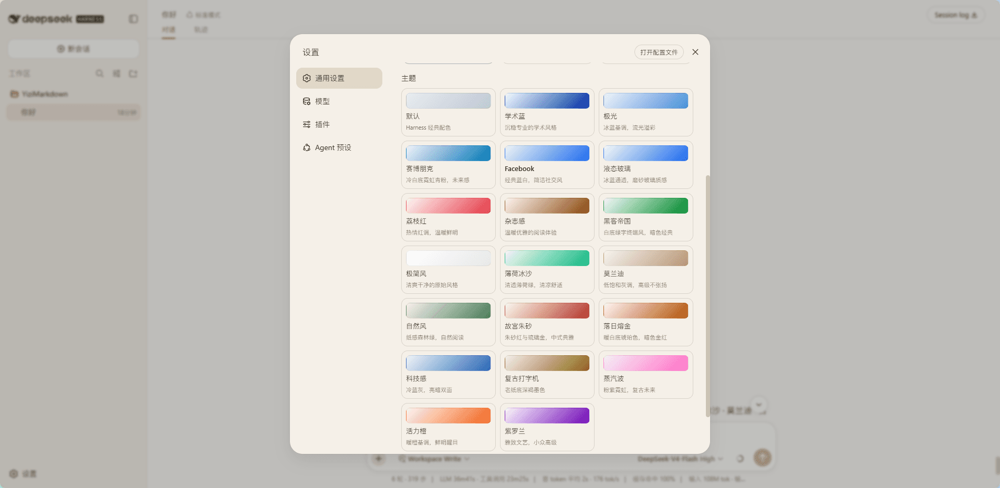

<div align="center">

# 🎨 DeepSeek Harness Yizi Themes

**19 个精品风格主题 + 自定义品牌 for [DeepSeek Harness](https://github.com/deepseek-ai/deepseek-harness) Web UI**

完整移植自 [YiziMarkdown](https://github.com/laoduu/YiziMarkdown) 的设计语言，
为 Harness 的 `--dsw-alias-*` 语义 token 体系量身定制。

**学术蓝 · 极光 · 赛博朋克 · Facebook · 液态玻璃 · 荔枝红 · 杂志感 · 黑客帝国 · 极简风 · 薄荷冰沙 · 莫兰迪 · 自然风 · 故宫朱砂 · 落日熔金 · 科技感 · 复古打字机 · 蒸汽波 · 活力橙 · 紫罗兰**

每个主题都同时支持 **亮色 / 深色** 两套配色，并跟随你的「浅色 / 深色 / 跟随系统」设置。

标准 **Cordis 插件**：`dsh plugin` 一键安装，不改动 Harness 源码。

[English](README.en.md) · [安装教程](#-安装教程) · [自定义品牌](#-自定义品牌) · [版本日志](CHANGELOG.md) · [开发日志](docs/DEVLOG.md) · [Agent 安装指引](docs/AGENT-SKILL.md)

</div>

---

## ✨ 特色

- 🎭 **19 个主题**：从极光流光到赛博朋克霓虹，从莫兰迪高级灰到故宫朱砂，总有一款配得上你的审美
- 🌈 **主题工作室 · 自定义主题**（0.5.6）：只选一个主题色，完整明暗两套配色**自动派生**（主色 / 墨色 / 底色浓度 / 描边风格 / 字号五个声部各自遵循预设手工调校的规律），卡片实时预览，保存后立刻出现在主题网格、选择器和 `/theme` 里（设置 → 外观 → 自定义主题）
- 🎚️ **高级调色**（0.5.6）：想自己动手时，可覆盖墨色、底色浓度、描边风格（品牌色 / 中性墨）与明暗底色；留空即自动，不必懂 OKLCH
- 🌗 **双模式**：每个主题都有精心调配的亮色 / 深色两套 token，跟随系统自动切换
- 🧩 **标准插件**：标准 Cordis 插件（`dsh plugin` 安装/卸载），不修改 Harness 仓库任何源码
- ✅ **干净 Harness 开箱即用**：风格主题由插件自实现（含持久化与 `body.theme-<id>` 应用），无需给 Harness 打任何补丁
- 🧩 **升级免疫（官方槽位）**：品牌（左上角 Logo / 字样 / 徽章 / 新会话标题）通过 Harness 官方品牌槽位渲染（`sidebar.brand.mark` / `sidebar.brand.name` / `conversation.hero.brand.mark`），并以更低 `priority` 注册，与标准构建自带的官方品牌插件共存且本插件生效；无槽位的旧核心自动回退到原 viewBox 注入路径
- 🧱 **本代适配（0.5.2）**：适配 `dsh-client-store` / `configForms` 一代（Harness ≥ `v0.1.2-alpha.1`，含 `0.2.0-rc.2` / `0.2.1-rc.2` / `0.2.1-rc.3` 桌面版）；自定义品牌持久化在浏览器本地（`localStorage`），不依赖 Harness 的设置传输层
- 🎚️ **正交双维度**：明暗模式与风格主题完全独立，可自由组合
- 🖌️ **自定义品牌**：左上角 Logo / 品牌字样 / 徽章 / 新会话标题全部可自定义，**颜色自动跟随主题与明暗**
- 📐 **品牌尺寸可调**（0.5.4）：左上角 Logo、品牌字样、徽章按同一倍率**整体缩放**（75%–200%，设置 → 外观 → 自定义 → 品牌尺寸），拖动即时生效、无需重启
- 🔤 **品牌映射**（实验性，默认关闭）：把界面/输出中出现的 "DeepSeek / 深度求索 / Harness" 替换为你设定的品牌词（开启后也绝不改写你正在输入的内容）
- ⌨️ **`/theme` 命令与 Doctor**（0.5.6）：输入框敲 `/theme` 直接切主题、列主题；`/theme doctor` 输出安装自检（模块命中、槽位、令牌覆盖率）
- 📍 **随处可切换**：会话头部右上角 + 新会话（无对话）时的浮动按钮

---

## 🖼️ 主题预览



| 主题 | 亮色基调 | 深色基调 | 设计语言 |
|---|---|---|---|
| **学术蓝** `academic` | 淡蓝白 `#f5f8ff` | 深蓝黑 `#0d1117` | #002FA7 深蓝品牌，沉稳专业 |
| **极光** `aurora` | 冰蓝 `#f0f5fa` | 深墨 `#0a0e1a` | 北极光流动的色彩 |
| **赛博朋克** `cyberpunk` | 冷白 `#f0f4f8` | 深黑 `#050508` | 霓虹青粉撞色，未来感 |
| **Facebook** `facebook` | 灰白 `#f0f2f5` | 深灰 `#18191a` | #1877F2 品牌蓝，社交卡片风 |
| **液态玻璃** `liquidglass` | 冰晶白 `#f6f9fe` | 深靛 `#0c1222` | 半透明玻璃质感 |
| **荔枝红** `lychee` | 淡红白 `#fff5f5` | 暗红黑 `#171212` | #E63946 热情红调 |
| **杂志感** `magazine` | 暖纸 `#faf8f5` | 深褐 `#1a1612` | 咖啡棕衬线阅读 |
| **黑客帝国** `matrix` | 白底 `#f5faf5` | 纯黑 `#000000` | 矩阵绿终端风 |
| **极简风** `minimal` | 纯白 `#ffffff` | 深灰 `#1a1a1a` | 清爽原始 |
| **薄荷冰沙** `mint` | 奶白 `#f5fbf8` | 深绿 `#0a1a14` | #10B981 清透薄荷 |
| **莫兰迪** `morandi` | 米白 `#f7f3ef` | 深褐 `#2c2926` | 低饱和高级灰 |
| **自然风** `nature` | 米黄纸 `#f5f2eb` | 深墨绿 `#1a1f1a` | 纸感森林绿 |
| **故宫朱砂** `palace` | 宣纸 `#faf6f0` | 深墨 `#201812` | 朱砂红 + 琉璃金 |
| **落日熔金** `sunset` | 暖白 `#fef8f0` | 深紫 `#0d0812` | 琥珀色暮光 |
| **科技感** `tech` | 冷蓝白 `#f0f4f8` | GitHub 深 `#0d1117` | 经典开发工具风 |
| **复古打字机** `typewriter` | 老纸 `#f5f0e8` | 深灰 `#1a1a18` | 深褐墨色书房 |
| **蒸汽波** `vaporwave` | 浅粉紫 `#f8f0f6` | 深紫黑 `#140a1e` | 粉紫霓虹复古未来 |
| **活力橙** `vibrant` | 暖橙白 `#fff8f2` | 深褐 `#1a1410` | #F3641E 鲜明醒目 |
| **紫罗兰** `violet` | 淡紫白 `#faf5fe` | 深紫黑 `#16101f` | #7209B7 雅致文艺 |

---

## 📦 安装教程

> **前置条件**：Harness **≥ v0.1.2-alpha.1**（`dsh-client-store` 一代；含 0.2.0-rc.2 / 0.2.1-rc.2 / 0.2.1-rc.3 桌面版）。
> 更老的 rc.5 / rc.8（客户端运行时仍为 `@deepseek-ai/dsh-client-runtime`）请用 0.3.x 版本。

### 方式一：从 GitHub Release 下载 tgz（推荐）

1. 下载 `dsh-yizi-themes-0.5.6.tgz` —— 在 [Releases 页面](https://github.com/laoduu/DeepSeek-Harness-yizi-themes/releases) 点击下载，或直接命令行拉取：

```bash
curl -L -o dsh-yizi-themes-0.5.6.tgz https://github.com/laoduu/DeepSeek-Harness-yizi-themes/releases/download/v0.5.6/dsh-yizi-themes-0.5.6.tgz
```

2. 停掉正在运行的 `dsh web`（Ctrl+C）；
3. 安装：

```bash
cd <你的 deepseek-harness 路径>
pnpm dsh plugin --profile web add /path/to/dsh-yizi-themes-0.5.6.tgz
```

> 💡 **桌面版（DSH Desktop App）用户**：把 `--profile web` 换成 `--profile desktop`，
> 安装到桌面版自己的 profile（`$DSH_HOME/profiles/desktop`）——web 与桌面版是两个独立 profile，互不相通。

4. 重启：

```bash
pnpm dsh web
```

### 方式二：从源码构建

```bash
# 克隆插件源码
git clone https://github.com/laoduu/DeepSeek-Harness-yizi-themes.git
cd DeepSeek-Harness-yizi-themes

# 构建并打包（prepare.mjs 从 Harness 仓库的 node_modules 解析 tsdown）
node prepare.mjs
npm pack          # 产出 dsh-yizi-themes-<version>.tgz
```

然后按方式一的 2-4 步安装、重启。

### ⚠️ 更新已有安装（同版本陷阱）

**同版本 tgz 内容变了，直接 `add` 不会更新**（pnpm 报 `Already up to date`）。

- 版本号**变了**：直接 `add` 即可；
- 版本号**没变**：必须先卸载再安装：

```bash
pnpm dsh plugin --profile web remove dsh-yizi-themes
pnpm dsh plugin --profile web add  /path/to/dsh-yizi-themes-<version>.tgz
```

### 使用

- **切换主题 / 明暗**：右上角调色板按钮 + 明暗切换按钮（会话头部）；新会话（无对话内容）时以浮动按钮显示在同一位置；也可以直接敲 `/theme`；
- **自己做主题**：设置 → 外观 → **自定义主题**——填名称、选主题色，卡片实时预览，点「添加主题」保存；已存主题带「应用 / 编辑 / 删除」，全部即时生效，无需重启（详见下节）；
- **自定义品牌**：设置 → 外观 → 自定义（见下节）。

---

## 🌈 主题工作室（自定义主题）

设置 → 外观 → **自定义主题**：

| 步骤 | 说明 |
|---|---|
| 1. 填名称 | 如「海之蓝」「樱花粉」（同名同色重复添加只会覆盖原主题，不会堆出多个） |
| 2. 选主题色 | 一个就行——明暗两套完整配色自动派生 |
| 3. 预览 | 卡片实时展示该配色在界面上的样子 |
| 4. 添加主题 | 立刻出现在上方主题网格、右上角选择器和 `/theme` 里 |

**高级调色**（可选，展开后可见）：想自己动手时，可覆盖

| 声部 | 作用 |
|---|---|
| **墨色** | 第二色相：文字、Toast 与深色页面的底色都跟随它（蓝色品牌默认自动 +43° 偏紫，与预设一致） |
| **底色浓度** | 背景染色的强度，越大越"有颜色" |
| **描边风格** | `品牌色`（彩色描边）或 `中性墨`（中性灰描边） |
| **亮底 / 暗底** | 直接指定明暗模式的页面底色 |

任何字段留空即保持自动推导。保存后仍可再次「编辑」，删除即时生效。

---

## 🖌️ 自定义品牌

设置 → 外观 → **自定义** 板块：

| 设置项 | 说明 |
|---|---|
| **Logo SVG** | 粘贴 SVG 代码或 data URI。用于**左上角品牌、收起侧边栏图标、新会话页图标**三处。留空用内置鲸鱼标 |
| **品牌字样** | 左上角品牌文字（默认 `DEEPSEEK`，基准 18px，随品牌尺寸缩放） |
| **徽章字样** | 品牌文字旁的徽章标签（默认 `HARNESS`） |
| **新会话标题** | 新会话页标题文案（默认 `探索未至之境`） |
| **品牌尺寸** | 滑块整体缩放左上角 Logo、品牌字样与徽章（75%–200%，默认 100%），拖动即时生效、无需重启；放大时侧边栏品牌行自动留出空间，不会裁切 |
| **品牌映射** | 开关（默认关闭，实验性）+ 映射表：把界面/输出中出现的 "DeepSeek Harness / DeepSeek / 深度求索 / Harness" 替换为设定词；开启后也不会改写输入框内容 |

**颜色自动跟随主题**：品牌字样、徽章背景、Logo 容器颜色统一使用 `--dsw-alias-brand-primary`，
切换任意风格主题或明暗模式时自动变化。

> **想让自己的 SVG 也跟随主题？** 把 SVG 里的硬编码颜色替换为：
> - `fill="var(--dsw-alias-brand-primary)"` —— 随主题与明暗自动切换；
> - `fill="currentColor"` —— 继承容器颜色（容器已设为主题色）。
>
> 其他可用变量：主文字 `--dsw-alias-label-primary`、次要文字 `--dsw-alias-label-secondary` /
> `--dsw-alias-label-caption`、反色文字 `--dsw-alias-label-primary-inverted`、
> 背景 `--dsw-alias-bg-layer-1`、边框 `--dsw-alias-border-l1` 等。

**持久化**：所有品牌设置（含品牌尺寸 `scale`）保存在**浏览器本地**（`localStorage` 键 `dsh-yizi-themes:brand`），
桌面版与 Web 版、不同浏览器各存各的，重启不丢失。

---

## ⚙️ 配置（cordis.patch.yml）

插件行的默认配置（可在 profile 的 `cordis.patch.yml` 里覆盖）：

| 字段 | 默认值 | 说明 |
|---|---|---|
| `wordmark` | `DEEPSEEK` | 品牌字样 |
| `wordmarkBadge` | `HARNESS` | 徽章字样 |
| `headline` | `探索未至之境` | 新会话标题 |
| `mappingEnabled` | `false` | 是否启用品牌映射 |
| `mappingDeepSeek` / `mappingDeepSeekChinese` / `mappingHarness` / `mappingDeepSeekHarness` | 原文 | 各品牌词的替换目标 |

设置页的修改优先级高于此配置（配置作为 base 层，用户层覆盖之）。

---

## 🗑️ 卸载

```bash
cd <你的 deepseek-harness 路径>
pnpm dsh plugin --profile web remove dsh-yizi-themes
```

重启 `dsh web` 即恢复默认外观。`settings.yaml` 里的 `ui-theme.customBrand` 属于核心命名空间，
卸载后仍保留（无副作用，可手工删除）。

---

## ❓ 常见问题

**Q: 更新后界面没变化？**
版本号没变则必须 `remove → add`（见上）；并完全重启 `dsh web`（Ctrl+C 后重启）+ 浏览器强刷 Ctrl+Shift+R。

**Q: 设置能输入但刷新后丢失？**
0.5.0 起自定义品牌与风格主题持久化在**浏览器本地**（`localStorage`：`dsh-yizi-themes:brand` / `dsh-yizi-themes:themeId`），不再写入 `$DSH_HOME/settings.yaml`。若刷新后丢失：确认不是隐私/无痕模式（localStorage 可能被禁用）；桌面版与 Web 版各存各的，互不同步。

**Q: 切换主题后左上角品牌颜色不变？**
确认 Logo/品牌字样已设置且为 `currentColor` 或 `var(--dsw-alias-brand-primary)`；硬编码颜色不会跟随主题。

**Q: 侧边栏折叠后重新展开空白？**
老版本 bug，升级到 0.2.2+。

**Q: 装上插件后 DeepSeek Harness Desktop 起不来？**
0.4.0 及更早的客户端 bundle 仍 `require('@deepseek-ai/dsh-client-runtime/client')`，而该包在 `dsh-client-store` 一代已被**整包删除**——桌面版的 web 引导是"任一 entry 激活失败即整体中止"，所以应用直接黑屏/打不开。0.5.0 已改用本代平台模块（`@deepseek-ai/dsh-client-store`）并适配收窄后的 `ui-theme` schema。
已经装坏、界面进不去时：命令行执行 `dsh plugin --profile desktop remove dsh-yizi-themes`（不需要打开界面），再完全退出并重启桌面版即可恢复；然后升级到最新版（当前 0.5.6）重新安装。

**Q: 装上插件后启动失败（`web boot: 1 entry did not activate` / `dsh-yizi-themes: failed`）？**
0.5.6 起插件**不会再让启动失败**：apply 的每个阶段都隔离兜底、插槽注册幂等，被重复加载（热重载 / 组合重载）也照常工作。若仍看到该报错，说明装的是 0.5.5 及更早版本（旧包在启动早期抛错会中止整个客户端引导）——`remove` 后重装 0.5.6 即可。
排查任何异常：浏览器 F12 → Application → Local Storage → `dsh-yizi-themes:bootlog`（最近 60 条启动轨迹，每阶段 `ok:` / `FAIL:`），`FAIL:` 一行就是根因所在阶段。

**Q: 装好能启动，但整个界面样式错乱 / 控件变形 / 主题点了没反应？**
0.5.6 已修（暗色配色推导里一个未声明变量会让整张样式表不发射，导致预设主题、行布局、品牌规则全部缺失）。确认版本 ≥ 0.5.6；若仍出现，同样看 `dsh-yizi-themes:bootlog` 里的 `FAIL:` 行。

**Q: 干净 Harness（官方源码 / npm 发布的 rc.5）能用吗？**
0.5.x 面向 `dsh-client-store` 一代（Harness ≥ `v0.1.2-alpha.1`，含 `0.2.0-rc.2` / `0.2.1-rc.2` 桌面版）；更老的 rc.5 / rc.8 请用 0.3.x。风格主题一直由插件自实现（`localStorage` 持久化 + 自行切换 `body.theme-<id>`），无需给核心打任何补丁；明暗切换仍走核心 `ctx.theme`。

**Q: 控制台报 `single slot "sidebar.brand.mark" already has a registration at priority 0`？**
旧版本以默认 priority 0 注册品牌槽位，与标准构建自带的官方品牌插件（`dsh-client-ui-brand-official`）撞车——single 槽位不允许同优先级的第二个占用者（报错里的 "registered by X" 指的是**已存在的**那个）。0.5.0 起本插件以 `priority: -100` 注册（single 槽位渲染最低优先级者），两者共存且本插件品牌生效。

**Q: Harness 升级到 v0.1.0-rc.8 后，自定义品牌失效了？**
0.3.x 起已适配。rc.8 把侧边栏品牌从单个 `BrandWordmark`（`viewBox="0 0 182 24"`）改成了官方品牌槽位（`sidebar.brand.mark` / `sidebar.brand.name` / `conversation.hero.brand.mark`）。插件改为注册这些槽位来渲染自定义 Logo / 字样 / 徽章 / 新会话标题——槽位是官方扩展面，**后续 Harness 升级只要保留槽位契约即可继续工作**；无槽位的旧核心自动回退到原 viewBox 注入路径。升级后若仍显示旧版，请先 `remove` 再 `add`（同版本内容变了 pnpm 会报 "Already up to date"）。

**Q: Harness 升级到 v0.1.2-alpha.1 后，插件启动报 `dsh-client-runtime` missed the module table？**
官方在新版移除了 `@deepseek-ai/dsh-client-runtime` 包，旧版插件（0.3.x）仍引用它导致加载失败。**升级到 0.4.0 及以上（当前最新 0.5.6）**（已迁移到 `@deepseek-ai/dsh-client-store` / `@deepseek-ai/cordis`）。若你已安装 0.3.x，先 `remove` 再 `add` 最新版，并完全重启 `dsh web`（Ctrl+C 后重启）+ 浏览器强刷 Ctrl+Shift+R。

**Q: 想让 agent 帮我装插件？**
把 [Agent 安装指引](docs/AGENT-SKILL.md) 交给 agent 即可。

---

## 🤝 贡献

欢迎提交 Pull Request：

- **新主题**：见 [开发日志](docs/DEVLOG.md) 与 `scripts/gen-themes.mjs`（CSS → TS 生成器）；
- **Bug 修复**：Harness 版本更新导致的适配问题；
- **文档改进**：安装教程、常见问题。

---

## 📄 文档

- [版本日志](CHANGELOG.md)
- [开发日志](docs/DEVLOG.md)
- [Agent 安装指引](docs/AGENT-SKILL.md)

---

## ⚖️ 许可

[MIT](LICENSE) © [老独](https://github.com/laoduu)

本项目是对 [DeepSeek Harness](https://github.com/deepseek-ai/deepseek-harness)（MIT）的第三方主题扩展；
主题设计语言移植自 [YiziMarkdown](https://github.com/laoduu/YiziMarkdown)。

> 旧版 `install.sh` / `install.ps1` / `MANIFEST.json` / `patch/` 为早期"源码覆盖"方案遗留，
> 已废弃，仅保留作参考，请勿使用。

---

<div align="center">

> A third-party `dsh-plugin` that brings 19 YiziMarkdown themes to DeepSeek Harness.

**如果这个项目对你有帮助，欢迎 ⭐ Star 支持！**

</div>
